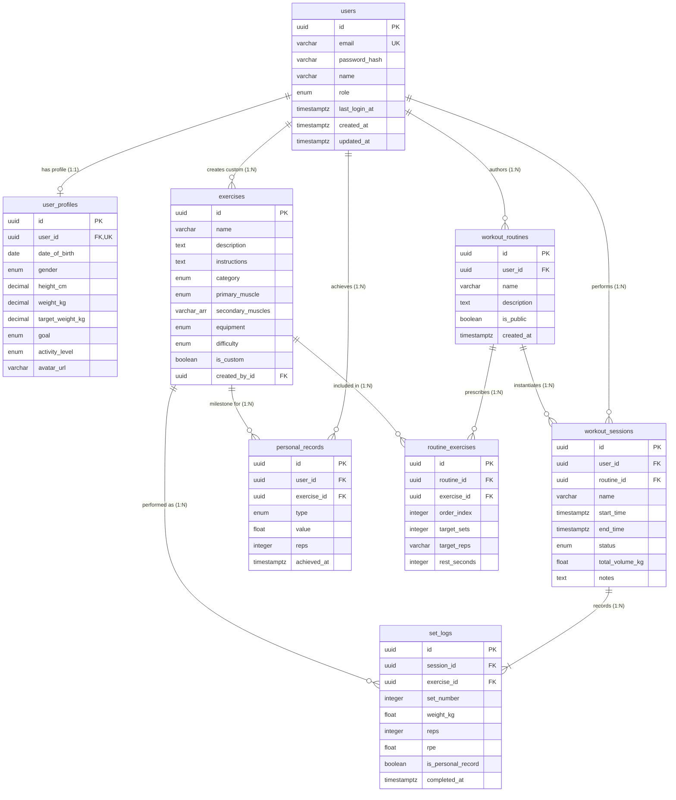

# Section B: ER Diagram and Data Modelling

## 1. Entities and Attributes Specification

The FitTrack database consists of 8 core normalized entities. All primary keys utilize Universally Unique Identifiers (UUID v4) to prevent enumeration attacks and facilitate distributed record generation.

### 1. `User` Entity (`users`)
Stores core identity and credentials for system authentication.
* `id` (UUID, Primary Key) — Unique identifier for the user.
* `email` (VARCHAR(255), Unique, Not Null) — User authentication email address.
* `password_hash` (VARCHAR(255), Not Null) — Bcrypt hashed password.
* `name` (VARCHAR(100), Not Null) — Full name of the user.
* `role` (ENUM: `USER`, `ADMIN`, Not Null, Default: `USER`) — Access control level.
* `last_login_at` (TIMESTAMP WITH TIME ZONE, Nullable) — Timestamp of last login.
* `created_at` (TIMESTAMP WITH TIME ZONE, Default: `NOW()`) — Registration timestamp.
* `updated_at` (TIMESTAMP WITH TIME ZONE, Default: `NOW()`) — Last profile modification.

### 2. `UserProfile` Entity (`user_profiles`)
Stores biometric parameters and fitness progression targets.
* `id` (UUID, Primary Key) — Unique identifier for the profile.
* `user_id` (UUID, Foreign Key -> `users.id`, Unique, Not Null) — References parent user.
* `date_of_birth` (DATE, Nullable) — User birth date for age-adjusted metabolic metrics.
* `gender` (ENUM: `MALE`, `FEMALE`, `OTHER`, Nullable) — Biological gender.
* `height_cm` (DECIMAL(5,2), Nullable) — Height in centimeters.
* `weight_kg` (DECIMAL(5,2), Nullable) — Current body weight in kilograms.
* `target_weight_kg` (DECIMAL(5,2), Nullable) — Goal body weight in kilograms.
* `goal` (ENUM: `STRENGTH`, `HYPERTROPHY`, `ENDURANCE`, `WEIGHT_LOSS`, Nullable).
* `activity_level` (ENUM: `SEDENTARY`, `LIGHT`, `MODERATE`, `VERY_ACTIVE`, Nullable).
* `avatar_url` (VARCHAR(500), Nullable) — Profile picture URL.
* `created_at` / `updated_at` (TIMESTAMP WITH TIME ZONE).

### 3. `Exercise` Entity (`exercises`)
Master catalog of strength and conditioning movements.
* `id` (UUID, Primary Key) — Unique exercise identifier.
* `name` (VARCHAR(150), Not Null) — Exercise title (e.g., "Barbell Bench Press").
* `description` (TEXT, Nullable) — Overview of the movement.
* `instructions` (TEXT, Nullable) — Form and biomechanical cues.
* `category` (ENUM: `BARBELL`, `DUMBBELL`, `MACHINE`, `CABLE`, `BODYWEIGHT`, Not Null).
* `primary_muscle` (ENUM: `CHEST`, `BACK`, `LEGS`, `SHOULDERS`, `ARMS`, `CORE`, Not Null).
* `secondary_muscles` (VARCHAR[] / TEXT[], Nullable) — Supporting synergist muscle groups.
* `equipment` (ENUM: `BARBELL`, `DUMBBELL`, `MACHINE`, `CABLE`, `BODYWEIGHT`, `NONE`).
* `difficulty` (ENUM: `BEGINNER`, `INTERMEDIATE`, `ADVANCED`, Default: `BEGINNER`).
* `image_url` (VARCHAR(500), Nullable) — Demonstration graphic asset.
* `is_custom` (BOOLEAN, Default: `FALSE`) — Indicates user-created custom exercise.
* `created_by_id` (UUID, Foreign Key -> `users.id`, Nullable) — Creator user ID if custom.
* `created_at` / `updated_at` (TIMESTAMP WITH TIME ZONE).

### 4. `WorkoutRoutine` Entity (`workout_routines`)
Saved workout split templates (e.g., "Push Day A", "Heavy Leg Day").
* `id` (UUID, Primary Key) — Unique routine identifier.
* `user_id` (UUID, Foreign Key -> `users.id`, Not Null) — Owner user identifier.
* `name` (VARCHAR(100), Not Null) — Routine title.
* `description` (TEXT, Nullable) — Goal or focus of this routine.
* `is_public` (BOOLEAN, Default: `FALSE`) — Whether community visible.
* `created_at` / `updated_at` (TIMESTAMP WITH TIME ZONE).

### 5. `RoutineExercise` Entity (`routine_exercises`)
Associative junction entity implementing **Many-to-Many** between `WorkoutRoutine` and `Exercise` with ordering and target prescription.
* `id` (UUID, Primary Key) — Unique junction identifier.
* `routine_id` (UUID, Foreign Key -> `workout_routines.id`, Not Null) — Parent routine.
* `exercise_id` (UUID, Foreign Key -> `exercises.id`, Not Null) — Target exercise.
* `order_index` (INTEGER, Not Null) — Execution sequence (1, 2, 3...).
* `target_sets` (INTEGER, Default: 3, Not Null) — Prescribed sets.
* `target_reps` (VARCHAR(50), Default: "8-12", Not Null) — Repetition range target.
* `rest_seconds` (INTEGER, Default: 90) — Prescribed inter-set rest period.
* `notes` (TEXT, Nullable) — Execution notes (e.g., "Pause at bottom").
* `created_at` / `updated_at` (TIMESTAMP WITH TIME ZONE).

### 6. `WorkoutSession` Entity (`workout_sessions`)
Realized execution instance of a workout performed by a user.
* `id` (UUID, Primary Key) — Unique session identifier.
* `user_id` (UUID, Foreign Key -> `users.id`, Not Null) — User who performed the workout.
* `routine_id` (UUID, Foreign Key -> `workout_routines.id`, Nullable) — Optional template source.
* `name` (VARCHAR(100), Not Null) — Session title (e.g., "Afternoon Chest Workout").
* `start_time` (TIMESTAMP WITH TIME ZONE, Default: `NOW()`, Not Null).
* `end_time` (TIMESTAMP WITH TIME ZONE, Nullable) — Workout completion time.
* `status` (ENUM: `IN_PROGRESS`, `COMPLETED`, `CANCELLED`, Default: `IN_PROGRESS`).
* `total_volume_kg` (DOUBLE PRECISION, Default: 0) — Aggregate tonnage lifted.
* `notes` (TEXT, Nullable) — Post-workout subjective notes.
* `created_at` / `updated_at` (TIMESTAMP WITH TIME ZONE).

### 7. `SetLog` Entity (`set_logs`)
Granular telemetry of every individual set performed.
* `id` (UUID, Primary Key) — Unique set identifier.
* `session_id` (UUID, Foreign Key -> `workout_sessions.id`, Not Null) — Parent session.
* `exercise_id` (UUID, Foreign Key -> `exercises.id`, Not Null) — Exercise performed.
* `set_number` (INTEGER, Not Null) — Chronological set number within the exercise.
* `weight_kg` (DOUBLE PRECISION, Not Null) — Weight loaded on barbell/dumbbell/machine.
* `reps` (INTEGER, Not Null) — Clean repetitions completed.
* `rpe` (DOUBLE PRECISION, Nullable) — Rate of Perceived Exertion (scale 1.0 to 10.0).
* `is_personal_record` (BOOLEAN, Default: `FALSE`) — Flag indicating if this set broke a PR.
* `completed_at` (TIMESTAMP WITH TIME ZONE, Default: `NOW()`).

### 8. `PersonalRecord` Entity (`personal_records`)
Historical record of verified performance peaks per exercise.
* `id` (UUID, Primary Key) — Unique PR record identifier.
* `user_id` (UUID, Foreign Key -> `users.id`, Not Null) — Athlete identifier.
* `exercise_id` (UUID, Foreign Key -> `exercises.id`, Not Null) — Exercise milestone.
* `type` (ENUM: `MAX_WEIGHT`, `MAX_VOLUME`, `ONE_REP_MAX`, Not Null) — PR criterion.
* `value` (DOUBLE PRECISION, Not Null) — Peak milestone magnitude (kg or kg-reps).
* `reps` (INTEGER, Nullable) — Rep count at which record was achieved.
* `achieved_at` (TIMESTAMP WITH TIME ZONE, Default: `NOW()`, Not Null).
* `created_at` / `updated_at` (TIMESTAMP WITH TIME ZONE).

---

## 2. Cardinality and Relationships Specification

1. **`User` to `UserProfile` (One-to-One / 1:1):**
   * Exactly one profile per user (`user_id` is defined as `UNIQUE` with `ON DELETE CASCADE`).
2. **`User` to `WorkoutRoutine` (One-to-Many / 1:N):**
   * A user can construct multiple routines; each routine belongs strictly to one user (`ON DELETE CASCADE`).
3. **`WorkoutRoutine` to `Exercise` via `RoutineExercise` (Many-to-Many / M:N):**
   * A routine contains multiple exercises; an exercise can belong to multiple routines. Resolved using the associative entity `routine_exercises` with compound unique constraint `(routine_id, order_index)`.
4. **`User` to `WorkoutSession` (One-to-Many / 1:N):**
   * A user completes hundreds of workout sessions over time (`ON DELETE CASCADE`).
5. **`WorkoutSession` to `SetLog` (One-to-Many / 1:N):**
   * A session aggregates 10 to 40 individual sets. If a session is deleted, its set logs are deleted in cascade (`ON DELETE CASCADE`).
6. **`Exercise` to `SetLog` (One-to-Many / 1:N):**
   * An exercise is performed across thousands of sets. Deleting an active exercise is restricted (`ON DELETE RESTRICT`) to protect historical logs.
7. **`User` to `PersonalRecord` (One-to-Many / 1:N):**
   * A user accumulates PRs across multiple exercises and metrics (`ON DELETE CASCADE`).
8. **`Exercise` to `PersonalRecord` (One-to-Many / 1:N):**
   * Compound unique constraint `(user_id, exercise_id, type)` ensures at most one active record per metric per exercise.

---

## 3. Entity-Relationship (ER) Diagram

