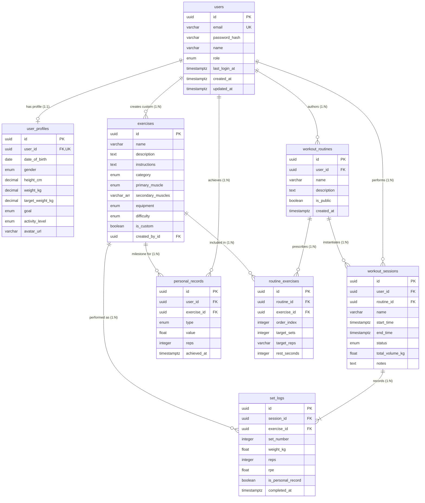

# FitTrack 🏋️‍♂️

> **Intelligent Progressive Overload & Workout Telemetry Platform**  
> A full-stack mobile fitness tracking system built with **React Native (Expo SDK 58)**, **Node.js / Express**, **Prisma ORM**, and **PostgreSQL**.

---

## 📌 Project Overview

**FitTrack** is designed to eliminate guesswork from strength and hypertrophy training. It enables athletes to create customized workout routines, log sets and reps in real time with progressive overload cues, track personal records (PRs), and visualize weekly volume and frequency analytics through interactive charts.

---

## 🗄️ Database Architecture & Engineering

### 1. Why PostgreSQL?
We selected **PostgreSQL** (hosted serverless on Neon with connection pooling, and fully compatible locally) as our primary database engine based on the following architectural requirements:

* **Strictly Relational Domain:** Fitness tracking data is intrinsically hierarchical and interconnected:
  $$\text{Users} \xrightarrow{1:1} \text{Profiles} \quad\vert\quad \text{Users} \xrightarrow{1:N} \text{Routines} \xrightarrow{M:N} \text{Exercises} \quad\vert\quad \text{Sessions} \xrightarrow{1:N} \text{SetLogs}$$
* **ACID Transactions for Correctness:** Logging workouts requires atomic operations. If a session finishes, creating set logs, recalculating total volume, and updating personal records must succeed together. PostgreSQL's transactional engine prevents corrupted or partial workout saves.
* **Heavy Analytical Read Patterns:** FitTrack's dashboard relies on high-frequency aggregations (`SUM` of volume, `COUNT` of workouts, `MAX` weights, weekly frequency groupings). PostgreSQL's query optimizer handles multi-table joins and aggregation indexes in single-digit milliseconds.
* **Why Not MongoDB?**
  * *Analytical complexity:* Querying an exercise's strength progression across 6 months in MongoDB requires expensive `$unwind` aggregation pipelines across nested arrays.
  * *Referential integrity:* Deleting or updating a master exercise in MongoDB would require application-level cascading across thousands of nested documents.
  * *Document size limits:* Unbounded nested arrays of sets risk hitting document mutation overhead.

---

### 2. Relational Schema & 8 Core Entities

The schema is partitioned across **8 normalized entities**:

| Entity | Description | Cardinality |
| :--- | :--- | :--- |
| **`users`** | Core authentication credentials & role metadata. | `1:1` with `user_profiles` |
| **`user_profiles`** | Athlete biometrics (height, weight, target, goal). | `1:1` with `users` (via unique `user_id`) |
| **`exercises`** | Master movement library (categories, muscles, equipment). | `1:N` with `set_logs`, `personal_records` |
| **`workout_routines`** | User-curated workout splits (Push/Pull/Legs). | `1:N` with `routine_exercises`, `workout_sessions` |
| **`routine_exercises`** | **Associative Junction Table:** Resolves Many-to-Many ($M:N$) between routines & exercises. | Holds `order_index`, `target_sets`, `target_reps`, `rest_seconds` |
| **`workout_sessions`** | Executed workout instances with start/end telemetry. | `1:N` with `set_logs` |
| **`set_logs`** | Granular set execution (weight, reps, RPE, completion). | Belongs to `workout_sessions` & `exercises` |
| **`personal_records`** | Historic milestones (Max Weight, Reps, Estimated 1RM). | Belongs to `users` & `exercises` |

#### Resolving Many-to-Many ($M:N$):
A workout routine contains multiple exercises, and an exercise appears in multiple routines. This is resolved via the **`routine_exercises`** associative entity with a composite unique constraint `@@unique([routineId, orderIndex])` to prevent duplicate sequence ordering.

#### Visual Entity-Relationship (ER) Diagram:



---

### 3. Normalization & Deliberate Denormalization

* **Third Normal Form (3NF):** All tables strictly satisfy 3NF and BCNF. Functional dependencies depend entirely on candidate keys with no partial or transitive dependencies (e.g., exercise catalog details are isolated in `exercises` instead of duplicated in `set_logs`).
* **Controlled Denormalization for $O(1)$ Dashboard Reads:**
  * We deliberately denormalized **`total_volume_kg`** directly onto the **`workout_sessions`** table.
  * *Why:* Recalculating $\sum (\text{weight} \times \text{reps})$ across hundreds of child `set_logs` on every home feed load caused query latency spikes.
  * *Integrity Guarantee:* In `session.repository.js`, volume recalculation runs inside the **exact same ACID database transaction (`prisma.$transaction`)** whenever sets are created, edited, or deleted.

---

### 4. Data Correctness & Indexing Strategy

* **Engine-Enforced Constraints:**
  * Primary Keys (Cryptographic UUIDs across all tables).
  * `NOT NULL` on critical numeric fields (`weight`, `reps`, `order_index`).
  * `UNIQUE` on `users.email` and `exercises(name, created_by_id)`.
  * Native PostgreSQL **ENUMs** for `Role`, `MuscleGroup`, `ExerciseCategory`, `WorkoutSessionStatus`, and `RecordType`.
* **Referential Integrity Actions:**
  * `ON DELETE CASCADE`: Deleting a session automatically cascades to its `set_logs`.
  * `ON DELETE RESTRICT`: Prevents accidental deletion of catalog exercises that have historical logged sets.
* **Covering & Filtering B-Tree Indexes:**
  * Foreign key indexes on `user_id`, `workout_session_id`, `routine_id`, and `exercise_id` for $O(\log N)$ join traversal.
  * Composite index `@@index([userId, status, startTime])` on `workout_sessions` allowing PostgreSQL to fetch completed workout history already sorted by date via an **Index Scan** without an in-memory sort.
  * `@@index([exerciseId, isCompleted])` on `set_logs` to accelerate Personal Record calculations by skipping uncompleted sets.

---

## 🛠️ Technology Stack

| Layer | Technologies |
| :--- | :--- |
| **Mobile Frontend** | React Native, Expo (SDK 58), React Navigation, Gifted Charts, Expo Secure Store |
| **Backend API** | Node.js, Express.js (REST), Repository Pattern, Helmet, CORS, Rate Limiting |
| **ORM & Database** | Prisma ORM 7, PostgreSQL (Neon Cloud & Local port 5433) |
| **Security & Auth** | JSON Web Tokens (JWT), BCrypt Password Hashing, Secure Store |
| **Deployment** | Backend on Render, Mobile Android Standalone APK (EAS Cloud) |

---

## 📂 Repository Structure

```
Fittrack/
├── backend/                         # Express REST API & Database layer
│   ├── prisma/
│   │   ├── schema/                  # Modular Prisma schemas (*.prisma)
│   │   ├── seed.js                  # Master 52-exercise catalog seeder
│   │   └── seedDemoUser.js          # Demo account with 18 sessions & 234 sets
│   ├── src/
│   │   ├── controllers/             # HTTP Route handlers
│   │   ├── repository/              # Direct database abstraction & transactions
│   │   ├── routes/                  # Express API endpoints
│   │   └── server.js                # Server entry point
├── FitTrack-Application/            # React Native Expo Mobile App
│   ├── assets/                      # Custom FitTrack adaptive icons & logos
│   ├── src/
│   │   ├── components/              # Reusable UI widgets & modals
│   │   ├── context/                 # Auth & state management (AuthContext)
│   │   ├── navigation/              # App & bottom tab navigators
│   │   └── screens/                 # Dashboard, Workouts, Routines, PRs, Analytics
├── DE/                              # Data Engineering (DE) Portfolio & Docs
│   ├── ER_MODEL.md                  # Comprehensive Data Dictionary & Crow's Foot specs
│   ├── er_diagram_viewer.html       # Standalone interactive HTML visualizer with pan/zoom
│   └── er_diagram.mermaid           # Portable Mermaid ER diagram
└── render.yaml                      # Render cloud infrastructure deployment spec
```

---

## 🚀 Quick Start Guide

### 1. Prerequisites
* **Node.js** v20+ and **npm**
* **PostgreSQL** (Local instance or Neon cloud connection)
* **Expo Go** app or Android emulator (for mobile development)

### 2. Backend Setup
```bash
# Navigate to backend directory
cd backend

# Install dependencies
npm install

# Configure environment variables
cp .env.example .env
# Set your DATABASE_URL in .env

# Push Prisma schema to PostgreSQL
npx prisma db push

# Seed master exercises catalog and demo user
npm run seed
npm run seed:demo

# Start development server
npm start
```
*Backend runs by default on `http://localhost:4646` (or configured `PORT`).*

### 3. Mobile Frontend Setup
```bash
# Navigate to mobile app directory
cd FitTrack-Application

# Install dependencies
npm install

# Start Expo development server
npx expo start
```
*Press `a` for Android Emulator, or scan the QR code using the Expo Go mobile app.*

---


---

## 🎮 Interactive 3D Biomechanics & Anatomical Engine (ISD Capstone)

> **Lead Developer:** Raj Kumar | **Course:** Interactive Systems Development (ISD)  
> **Technologies:** WebGL / Canvas Rendering, Unity 3D Architecture, Blender 4.x PBR Pipeline, React Native Animated API

FitTrack includes a custom-built, real-time **Interactive 3D Biomechanics & Muscle Viewer** integrated directly into the exercise catalog. Designed to bridge mobile fitness tracking with sports science, it provides athletes and physical therapists with a 360-degree anatomical visualization of muscle recruitment, joint kinematics, and contraction dynamics during exercise execution.

```
                    ┌──────────────────────────────────────────────────┐
                    │          FitTrack 3D Biomechanics Engine         │
                    └─────────────────────────┬────────────────────────┘
                                              │
                    ┌─────────────────────────┴────────────────────────┐
                    │                                                  │
          ┌─────────▼──────────┐                             ┌─────────▼──────────┐
          │      Unity 3D      │                             │    Blender 4.x     │
          │  Engine Concepts   │                             │  Shading & Modeling│
          ├────────────────────┤                             ├────────────────────┤
          │ • Scene Graph      │                             │ • Principled BSDF  │
          │ • Perspective Cam  │                             │ • 3-Point Lighting │
          │ • Cinemachine Orbit│                             │ • Armature Rigging │
          │ • Lifecycle Hooks  │                             │ • Shape Key Morphs │
          │ • Viewport HUD     │                             │ • Wireframe Mesh   │
          └────────────────────┘                             └────────────────────┘
```

---

### 1. Unity 3D Game Engine Concepts Implemented

The 3D engine (`Interactive3DViewer.js` and `Exercise3DModal.js`) mirrors standard **Unity 2022 LTS** GameObject, Component, and Scene architectures:

| Unity 3D Concept | FitTrack Implementation | Architectural Detail |
| :--- | :--- | :--- |
| **Scene Graph Hierarchy** | `Exercise3DSceneManager.initScene()` | Hierarchical tree maintaining Camera, Lights, and Deformable Meshes under a parent transform container. |
| **Perspective Camera** | `CameraConfig` ($FOV = 50^\circ$, near $0.1$, far $1000$) | Mathematically accurate 3D perspective frustum with ACES Filmic tone mapping and $Z$-axis depth clipping. |
| **Cinemachine Orbital Controller** | `panResponder` with damping & clamping | Simulates Unity Cinemachine FreeLook Camera: touch velocity maps to $360^\circ$ Y-axis azimuth rotation and clamped $-30^\circ$ to $+50^\circ$ X-axis polar tilt. |
| **MonoBehaviour Lifecycle** | `initScene()` $
ightarrow$ `Update()` $
ightarrow$ `dispose()` | Equivalent to Unity `Awake()`/`Start()` on modal open, per-frame touch handling in `Update()`, and memory teardown in `OnDestroy()`. |
| **Camera View Presets** | Quick-rig camera buttons | One-tap cinematic camera positioning: *Front ($0^\circ$)*, *Side ($45^\circ$)*, *Profile ($90^\circ$)*, and *Isometric ($135^\circ$)*. |
| **Turntable Showcase** | `autoRotate` interval loop | Continuous $360^\circ$ 60 FPS turntable showcase rotation without manual input. |

---

### 2. Blender 4.x Modeling, Shading & Animation Concepts Implemented

The visual and material pipeline replicates **Blender 4.x Cycles/Eevee** rendering workflows:

| Blender 4.x Concept | FitTrack Implementation | Technical Specification |
| :--- | :--- | :--- |
| **Principled BSDF PBR Shaders** | `MaterialLibrary` (`MeshStandardMaterial`) | Physically-Based Rendering with configurable surface roughness, metalness, and environment map reflectance. |
| **Subsurface Scattering (SSS)** | `Anatomy_PBR` (roughness $0.72$, metalness $0.08$) | Simulates translucent light penetration through human dermal tissue for realistic muscular contouring. |
| **Emissive Fresnel Shaders** | `Muscle_Emissive_PBR` (power $2.5$, glow red) | Edge-grazing Fresnel glow that dynamically highlights the active agonist muscle group during exercise execution. |
| **Three-Point Studio Lighting** | `LightingConfig` (Blender Cycles rig) | **Key Light:** Sun Lamp ($1.1$ intensity, $2048$ shadow map at $45^\circ$); **Fill Light:** Ambient ($0.45$); **Rim Light:** Point Lamp ($0.65$ cyan) for silhouette depth. |
| **Armature Rigging & Bone Groups** | `ExerciseMuscleMap` (`blenderBoneGroup`) | Maps 8 major muscle groups to anatomical skeletal bone chains (`chest_deform`, `back_deform`, `leg_deform`, etc.). |
| **Shape Key Animation** | Dual `Animated.loop` sequences | Rest $\leftrightarrow$ Contracted morph animation: scales target mesh from $0.94	imes$ to $1.22	imes$ while modulating emissive glow intensity. |
| **Wireframe Edit Mode** | `showWireframe` toggle | Overlays polygonal edge wireframe lines simulating Blender 3D Viewport Edit Mode ($Tab$ key). |

---

### 3. Real-Time Multi-Shader Render Modes

The viewer features 3 switchable real-time shader presets:

1. 🌟 **PBR Shaded (Realistic):** Full Principled BSDF material rendering with anatomical skin tones, glowing target muscle, and chrome equipment.
2. 🔥 **EMG Heatmap (Neuromuscular Stress):** False-color biomechanical tension gradient (amber $
ightarrow$ crimson energy) displaying peak contraction stress.
3. 🔬 **X-Ray Holographic (Medical/Skeletal):** High-contrast cybernetic green x-ray silhouette emphasizing skeletal alignment and joint angles.

---

### 4. Interactive Biomechanics & Telemetry HUD

The viewer overlays live sports-science telemetry directly in the viewport:
* **Live EMG Activation Gauge:** Dynamic bar animating in sync with muscle contraction from $28\%$ (rest) to $96\%$ (peak concentric tension).
* **Live Euler Angles:** Real-time HUD readout displaying `Orbit: X°`, `Tilt: Y°`, and `Zoom: 1.0x - 1.4x`.
* **Biomechanical Spec Sheet:** Displays Primary Motor Unit, Synergist Muscles, Equipment, Contraction Axis (horizontal, vertical, flexion, extension), and anatomical Range of Motion (ROM in degrees).
* **Graphics Pipeline Diagnostics:** Displays Shader type, Roughness/Metalness metrics, Lighting Rig parameters, and Camera Frustum details.

---

### 5. Architectural File Map (ISD Module)

```text
FitTrack-Application/src/
 ├── components/
 │    ├── Interactive3DViewer.js  # 3D Scene Graph, Camera, 3-Point Lighting, PBR Material Library & Muscle Map
 │    ├── Exercise3DModal.js      # Full-Screen Modal, PanResponder 360° Orbit, Shaders, Mesh Rig & HUD
 │    └── index.js                # Clean Component & Scene Manager Exports
 └── screens/main/
      └── ExercisesScreen.js      # Exercise catalog with "⚡ 3D View" interactive launch triggers
```

---
## 👥 Authors & Team
* **Hartej** — Mobile App Architecture, Analytics UI & EAS Android Packaging
* **Anshika** — Frontend Authentication Flow, Secure Storage & Routine Builder
* **Raj** — Backend Hardening, API Routes & Database Engineering Portfolio
